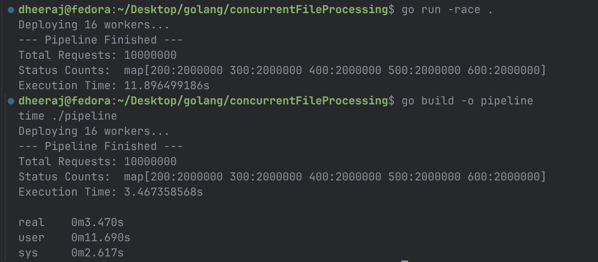

## Terminologies
Before we began with this project there are some important terms to know to understand things precisely and with clarity

* **Concurrency vs Parallelism**: Concurrency is about managing many tasks at once, yes one task might had to wait until other is finished, where parallelism is what we try to achieve using concurrency(it is not parallel in real, we try to make the system look like that it is doing many tasks at once). Parallelism is doing true parallel work , when two chefs are cooking at same time , this is true parallel, but when only one chef is cutting onions and stirring the dish as well it is concurrency
* **Context Switching**: As told in concurrency ,we try to to manage many tasks at once, this switching from one task to another is what happens in CPU , known as context switching, basically the task which CPU was performing is pasued , stored in program counter register , the task need to be performed its instructions are loaded to CPU and new task is carried, in this whole process the context for the CPU changed for which it was performing the task

## Theory
Ok think of the context ,as there is a very large file that you must read to deduce some metrics or generate report or even narrow down the bug, the intuition is that i can read the file line by line and update the variables being tracked

But Whenever we load some kind of data ,say `string`, (here in golang) It makes a `StringHeader` that consists of :
- A Pointer (memory address) pointing to where the actual text bytes live (8 bytes on a 64-bit system).
- A Length integer tracking how long the string is so Go prevents buffer overflows (8 bytes).
- Making total = 16 Bytes per string

This is the exact metadata overhead needed when loading large file. If orginal size is 10 GB , then final size in RAM would be much higher 

> **This will cause OOM(Out of Memory) Error**<br>
> *To solve this problem we stream the data in O(1) time*

Fine.

It will do the job, but this is a single threaded method, means many of your CPU cores are sitting idle, taking minutes to complete the job that can be done in seconds. What?

Let us assume the CPU has only 8 cores.

A `process`(workshop) entity deploys threads(workers) to actually execute instructions.

* One core only recevies one thread
* Now our _single threaded script_ only utilizes a single core to read the file , to track variables and to produce the result ,while 7 others are resting
* Other cores  can pe put to work to make things faster, so we deploy more threads to give work to each core

#### Before we move forward, it is important to understand `goroutines` and `channels` in _golang_

## What is a go routine?
In low level languages like C++, when we ask for a new thread to OS, it is a heavy entity. It requires 1-2MB of RAM plus TCP (thread control block)
**Goroutine** is a thread completely managed by go complier. It is very lightweight (only costs 2KB) and numerous can be spawned on a system
They also grow in size if needed.

Now say i spawn 10,000 goroutines on a 8 core CPU. How does it map?
## M : N Scheduler
Go ships with a hidden engine inside your compiled binary called the Go Scheduler. It uses a mathematical model called M:N scheduling. It maps M number of Goroutines onto N number of OS Threads.

- Imagine your 8-core CPU is a restaurant kitchen with exactly 8 workbenches (OS Threads).
- The Go Scheduler creates exactly 8 OS Threads and pins them to your 8 CPU cores.
- Next to each workbench, the Scheduler hangs a clipboard (a local queue).

When you spawn 100,000 Goroutines, the Scheduler deals them out like a deck of cards, putting 12,500 tasks on each clipboard.
The 8 OS threads just look at their clipboards and execute tasks one by one. True parallelism is achieved because all 8 benches are working simultaneously, but the OS only ever sees 8 standard threads. It has no idea Go is juggling 100,000 tasks inside them.
#### Work Stealing (The Scheduler's Genius)
What happens if Workbench 1 gets 10,000 really fast tasks, but Workbench 2 gets a task that takes 5 minutes (like downloading a file)?
Workbench 1 finishes early and sits empty. That wastes CPU power.

To fix this, the Go Scheduler uses a brutal efficiency tactic called Work Stealing.

If a worker finishes its clipboard, it looks around the room, walks over to Workbench 2, and literally steals half of the tasks off Workbench 2's clipboard. This guarantees that as long as there is work to be done, all 8 CPU cores stay pegged at 100% efficiency.

## What are Channels?
> Go has a philosophy : _"Do not communicate by sharing memory; instead, share memory by communicating."_

Channels are basically piplines , designed to carry only one type of datatype, allowing independent goroutines to send and receive data to one another
* A Thread-Safe Data Pipe: A channel guarantees that only one Goroutine can receive a specific piece of data. If you push the string "Line 1" into a channel, and 8 workers are trying to read from it, Go ensures exactly one worker gets "Line 1". There is no memory overlap, and therefore no need to write manual locks or mutexes.

* A Synchronization Traffic Light: As discussed with the Go Scheduler, channels control the flow of execution. If a worker tries to pull from an empty channel, the channel instantly signals the Scheduler to put that worker's Goroutine to sleep. If a worker tries to push into a full channel, the sender is put to sleep.

 ```go
 jobs := make(chan string) // A conveyor belt that ONLY accepts strings
 jobs <- "Line 1" // The Producer puts a string onto the belt
 line := <-jobs // A Worker takes the string off the belt
 ```

 ### Types of Channels
To understand the different types, you just need to look at whether the tube has a storage area, and which way the items are allowed to flow.

Types by Storage (Buffering):
* **Unbuffered Channels (No Storage)**: Imagine passing a baton in a relay race. The sender holds out the baton and must freeze in place until the receiver physically grabs it. There is no table to set the baton down on. Both workers must meet at the exact same moment for the handoff.
* **Buffered Channels (Has a Waiting Area)**: Imagine a neighborhood mailbox that holds exactly 10 letters. You drop your letter in and immediately walk away. You only get stuck waiting if the mailbox is completely stuffed full. The mail carrier grabs the letters whenever they want, and only gets stuck waiting if the box is totally empty.

Types by Direction (Function Permissions)
When you hand a channel to a specific worker (a function), you can restrict their permissions so they don't accidentally misuse it.
* **Bidirectional (`chan`)**: A two-way walkie-talkie. The worker can both speak into it (send) and listen from it (receive).
* **Send-Only (`chan<-`)**: A mail slot on a locked door. The worker can push letters in, but they cannot reach their hand back through the slot to read what's inside.
* **Receive-Only (`<-chan`)**: An airport luggage carousel. The worker stands there and grabs bags as they come out. They are not allowed to throw their own bags onto the belt.

## Concurrent File/log Processing
This project aims to create a pipeline capable enough to ingest large files, parses it to extract meaningful info and make analytics report
Constraint: It must process gigabytes of data in seconds while keeping memory usage completely flat and maximizing all CPU cores.


### Architecture

```
 ┌──────────────┐       jobs channel        ┌──────────────────┐       results channel      ┌───────────────┐
 │   PRODUCER   │ ────────────────────────► │   WORKER POOL    │ ─────────────────────────► │   COLLECTOR   │
 │              │      (buffered chan)      │  (N Goroutines)  │       (buffered chan)      │               │
 │ Reads file   │                           │                  │                            │ Aggregates    │
 │ line-by-line │                           │ Parses / Computes│                            │ metrics &     │
 │ (Bufio/Scan) │                           │ transforms logs  │                            │ summary       │
 └──────────────┘                           └──────────────────┘                            └───────────────┘
        │                                             ▲                                             │
        │                                             │                                             │
        └─────────────── context.Context ─────────────┴─────────────────────────────────────────────┘
                                  (Cancellation / Timeouts)
```

Stage 1: The Producer (Data Ingestion)
- A single Goroutine opens the log file and streams it line-by-line.
- It packages each raw text line into a structured "Job" and pushes it onto a buffered channel called jobs.
- Because it uses a buffer, if the Producer reads faster than the system can process, the channel fills up. This creates natural backpressure, pausing the Producer until space clears so memory never balloons.

Stage 2: The Worker Pool (Fan-Out)

- We deploy a fixed team of Goroutines (e.g., matching your system's CPU core count) to act as the processing engine.
- They all simultaneously listen to the jobs channel. As log lines arrive, the Go Scheduler distributes them evenly across the active CPU cores.
- Each worker parses its assigned text line, extracts the target metrics, packages them into a "Result" object, and pushes it onto a second channel called results.

Stage 3: The Collector (Fan-In)

- A single dedicated Goroutine sits at the end of the results channel.
- It receives the parsed metrics from all the workers and tallies them into a central ledger (e.g., incrementing a counter for 404 Not Found errors or calculating average response times).
- Because only this one Goroutine touches the final ledger, there is zero risk of memory collisions, meaning you never have to write a mutex or lock.
#### Synchronization
The hardest part of a concurrent pipeline is shutting it down cleanly without leaving "zombie" Goroutines trapped in infinite waiting loops. We manage this through a precise chain reaction:

- **The EOF Trigger**: The Producer finishes reading the last line of the file and immediately calls `close(jobs)`.
- **The Worker Drain**: The workers finish parsing whatever lines are currently sitting on the conveyor belt. Once empty, their channel-reading loops automatically break. As each worker clocks out, they decrement a central coordination counter (a `sync.WaitGroup`).
- **The Bridge**: A separate, invisible monitor Goroutine does nothing but watch that WaitGroup. The exact millisecond the last worker clocks out, this monitor calls `close(results)`.
- **The Final Tally**: The Collector realizes the results channel is closed, prints the final analytics report to your terminal, and the program exits cleanly in under a second.


## What is `sync.WaitGroup` ?
When your `main()` function reaches its final line of code, it instantly terminates the program. It does not care if you have 10,000 Goroutines running in the background. It doesn't wait for them to finish. It just turns off the lights, and every active Goroutine is instantly killed mid-sentence.

A WaitGroup acts as a physical sign-in/sign-out sheet to prevent this.

The 3 Commands of a WaitGroup :

A WaitGroup is literally just an integer counter that is safe to use across multiple threads. It has exactly three methods:
* **_`wg.Add(1)` (The Sign-In)_**: You call this before you launch a Goroutine. It tells the counter, "I am hiring 1 worker. The count is now 1."

* **_`wg.Done()` (The Sign-Out)_**: The worker calls this right before it dies (usually using defer `wg.Done()`). It tells the counter, "I am going home." It is just a shortcut for wg.Add(-1).

* **_`wg.Wait()` (The locked door)_**: This acts as a brick wall in your code. Whichever Goroutine calls `wg.Wait()` will freeze in place and cannot move to the next line of code until the internal counter hits exactly 0.

In our pipeline, the Monitor Goroutine hits `wg.Wait()` and freezes. It is physically blocked from running `close(results)`. As the 8 workers finish the file, they call `wg.Done()`. The counter goes 8... 7... 6... down to 0. The exact nanosecond it hits 0, the brick wall vanishes, the Monitor steps forward, and safely closes the channel.

## Generated 10 million log files
```bash
awk 'BEGIN { for(i=1; i<=10000000; i++) printf "GET /api/data %d\n", 200 + (i % 5) * 100 }' > server.log
```

